# DSCubed Recruitment Website: Design Document (2027 Semester 1)

| Field | Value |
|---|---|
| **Status** | Draft v1 |
| **Last updated** | 15 November 2026 |
| **Scope** | Round 1 (written application) of 2027 Semester 1 recruitment |

## 1. Purpose and scope

DSCubed currently collects applications through Google Forms, and committee members then copy each applicant's details and responses by hand into a Notion recruitment page. Directors use that page to take notes during the later interview rounds.

This project replaces that process with a small website that:

1. presents DSCubed and its open roles in the style of a careers page;
2. collects round 1 applications through a form; and
3. writes each application **directly** into a Notion database, already formatted for review and note-taking.

**In scope**

- Landing page (about DSCubed, the roles, the recruitment timeline, "Apply now").
- Application form with role-dependent questions.
- Server-side validation, spam protection and a duplicate-email check.
- Export to Notion, including the resume.

**Out of scope**

- Rounds 2 (group interview) and 3 (individual interview). Directors manage these in Notion.
- Confirmation emails, applicant accounts, and editing an application after submission.
- Support for multiple recruitment cycles. The site is built for 2027 S1, and the 2027 S2 changes will be made by hand.
- AI screening. The design allows for it (Section 11), but it will be built later.

## 2. Requirements

### 2.1 Functional requirements

| ID | Requirement |
|---|---|
| FR1 | The landing page (`/`) describes DSCubed, every open role and the recruitment timeline. The "Apply now" link is at the bottom of the page. |
| FR2 | The form (`/apply`) collects full name, student email, degree, expected graduation, first and second preference roles, three responses, a resume, and which group interview sessions and individual interview days the applicant can attend (at least one of each). |
| FR3 | The applicant must choose **exactly two different roles**, ranked as first and second preference. |
| FR4 | There are exactly three questions: one general question, the first-preference role's question, and the second-preference role's question. A role asks the same question whichever rank it is given. |
| FR5 | Each response is limited to **200 words**. |
| FR6 | A resume is **required**. It must be a PDF of at most 4 MB. |
| FR7 | Only **one application per email address** is accepted. The comparison ignores case and surrounding whitespace. |
| FR8 | Submissions are accepted only between the opening and closing times. |
| FR9 | Each valid application creates exactly one Notion page containing its properties, its responses and empty interview-notes sections. |
| FR10 | The applicant sees a success message only after Notion has confirmed that the page was created. |

### 2.2 Non-functional requirements

| ID | Requirement |
|---|---|
| NFR1 | **Cost:** the site runs on free tiers only (Vercel Hobby, Cloudflare Turnstile, and the existing Notion Plus workspace). |
| NFR2 | **Scale:** the site handles 80 to 120 applications per cycle, with bursts of a few per minute near the deadline. |
| NFR3 | **Reliability:** no submission is silently lost. The applicant's draft survives a refresh or a failed submission. |
| NFR4 | **Security:** the Notion token stays on the server, and the integration can access only the 2027 S1 database. |
| NFR5 | **Maintainability:** all recruitment content (roles, questions, dates) lives in one config file. |
| NFR6 | **Extensibility:** AI screening can be added without changing how applications are submitted. |

## 3. Key design decisions

| # | Decision | Rationale | Trade-off accepted |
|---|---|---|---|
| D1 | **No database.** Notion is the system of record. | At about 100 applications, every reason for a database has a simpler answer (D4, D5, D9). There is also no schema to maintain. | If Notion has an outage, nobody can apply until it recovers. |
| D2 | **SvelteKit + TypeScript, hosted on Vercel Hobby.** | The team already knows Svelte and TypeScript. One codebase holds both the frontend and the backend, so they can share types and the config. Hosting is free. | Vercel limits a request body to about 4.5 MB, which caps the resume size (D8). |
| D3 | **One config file drives the landing page, the form and validation.** | Roles, questions and dates are edited in one place, and TypeScript catches mistakes when the site is built. | Changing the content needs a redeploy (a git push). |
| D4 | **Synchronous submission.** The applicant sees success only after Notion confirms. | There is never a false "success". The draft saved in the browser allows a safe retry. | A submission takes a few seconds while the Notion calls complete. |
| D5 | **Uniqueness by normalised email,** checked with a Notion query. | No separate store is needed. | Two submissions with the same email in the same second could both get through. That risk is accepted. |
| D6 | **Cloudflare Turnstile plus a honeypot field.** | Both are free and almost invisible to applicants, and they stop bots from creating junk Notion pages. | There is no IP rate limiting, which would need storage. |
| D7 | **One question per role, the same for either rank.** | The page is predictable for reviewers, and the config type enforces the rule. | Directors cannot ask rank-specific questions. |
| D8 | **The resume is uploaded to Notion through its File Upload API.** It must be a PDF of at most 4 MB. | The resume sits on the applicant's page with no extra storage. | The 4 MB limit (from D2) is a little stricter than ideal. |
| D9 | **AI screening runs as a separate batch job** that writes its results back to Notion. | It never blocks or slows a submission, it needs no queue infrastructure, and it can be re-run. | Scores appear only after the job has been run. |
| D10 | **Built specifically for 2027 S1.** | Keeps the site simple. Steven updates it by hand for 2027 S2. | No automatic support for multiple cycles. |

## 4. Architecture model

### 4.1 System context

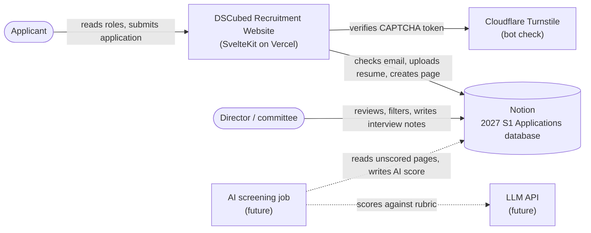

The website talks to only two external services. Directors never use the website; they work entirely in Notion. Dashed edges show the future AI extension.

### 4.2 Component view

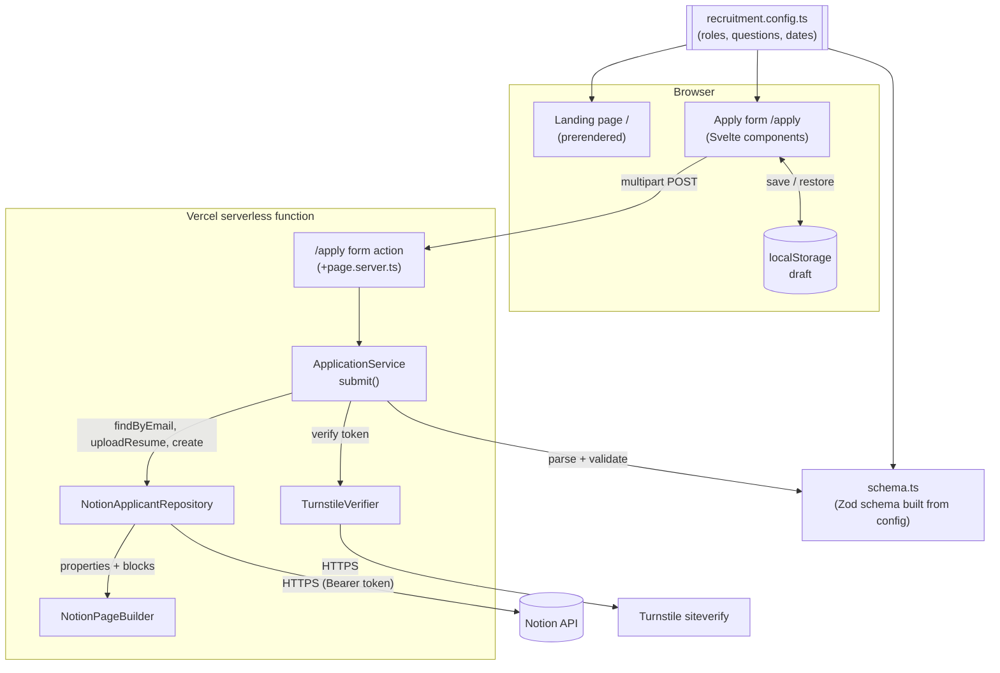

### 4.3 Layers and dependency rule

| Layer | Contents | May depend on |
|---|---|---|
| Presentation | Svelte routes and components (`src/routes`, `src/lib/components`) | Application, Domain |
| Application | `ApplicationService`, which runs the submission steps in order | Domain, plus the *interfaces* of Infrastructure |
| Domain | Config types, the `Application` type, the Zod schema, word counting | nothing |
| Infrastructure | `NotionApplicantRepository`, `NotionPageBuilder`, `TurnstileVerifier` | Domain |

`ApplicationService` does not import SvelteKit. It depends on the `ApplicantRepository` and `CaptchaVerifier` **interfaces**, so:

- unit tests can pass in fakes without calling Notion or Cloudflare; and
- the future AI job can reuse the same repository.

### 4.4 Deployment view

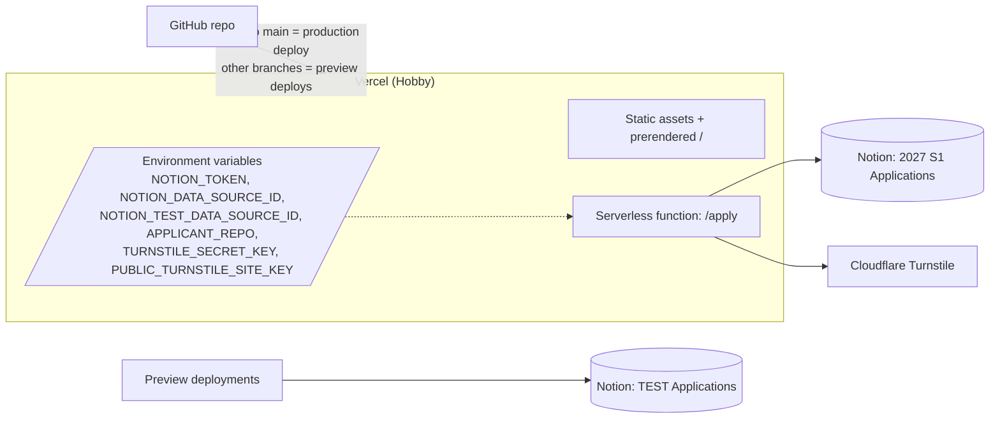

Preview deployments use a separate **test** Notion database, so development submissions never appear in the real database. Only production (`VERCEL_ENV=production`) reads `NOTION_DATA_SOURCE_ID`; every other environment reads `NOTION_TEST_DATA_SOURCE_ID`. Outside production the site uses an in-memory fake store unless `APPLICANT_REPO=notion` is set.

## 5. Design models

### 5.1 Domain model

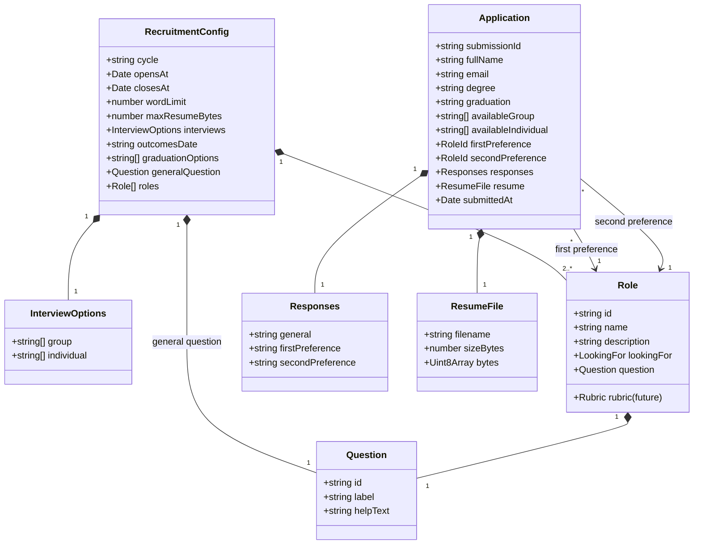

**Invariants**

- `firstPreference` is not equal to `secondPreference`, and both are IDs of roles in the config.
- Each of the three responses has between 1 and 200 words and at most 2,000 characters.
- `email` is stored trimmed and in lowercase.
- `graduation` is one of `graduationOptions`.
- `availableGroup` and `availableIndividual` each hold at least one option from `interviews.group` and `interviews.individual`, deduplicated and in config order.

### 5.2 Server module model

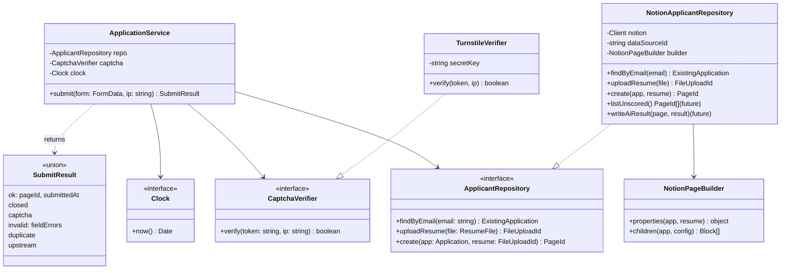

`Clock` is an interface so that tests can simulate submissions before the opening time and after the closing time. Outside production, the `FAKE_NOW` environment variable sets it for local testing.

`findByEmail` returns the stored page's ID, submission ID and submission time, or nothing. The service uses the submission ID to recognise a retry of an application that already went through (Section 6.4).

### 5.3 Form state model (client)

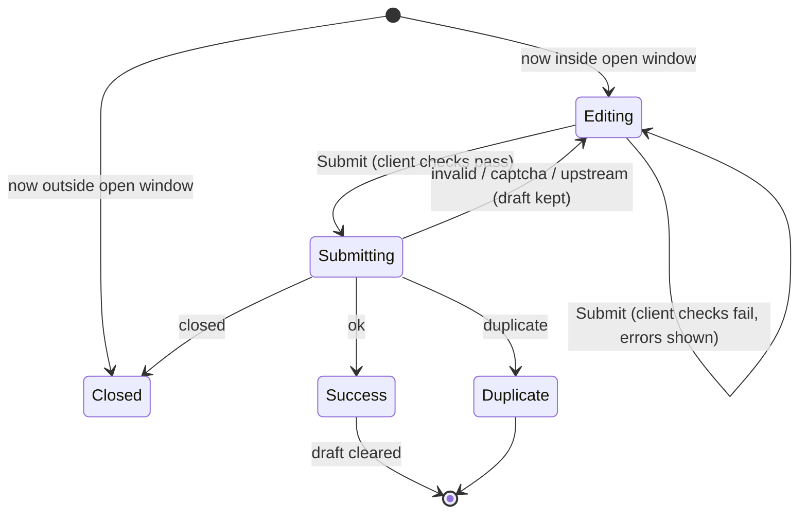

### 5.4 Applicant lifecycle in Notion

The website only ever sets **Applied**. Directors move each page through the later stages by hand.

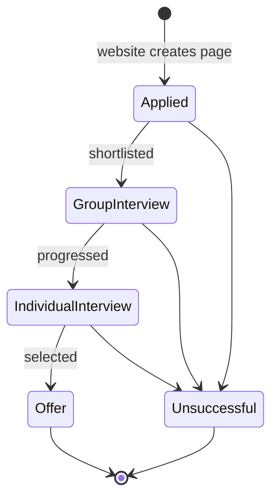

In Notion, the `Stage` status property groups these as follows: **To-do** = Applied; **In progress** = Group interview and Individual interview; **Complete** = Offer and Unsuccessful.

## 6. Sequence diagrams

### 6.1 Browsing and opening the form

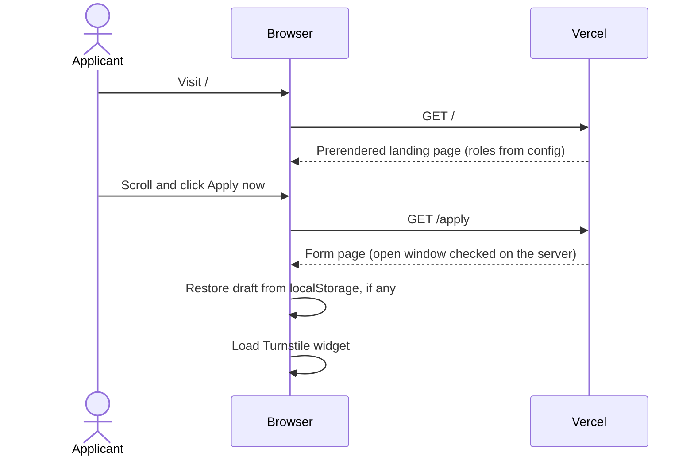

### 6.2 Successful submission

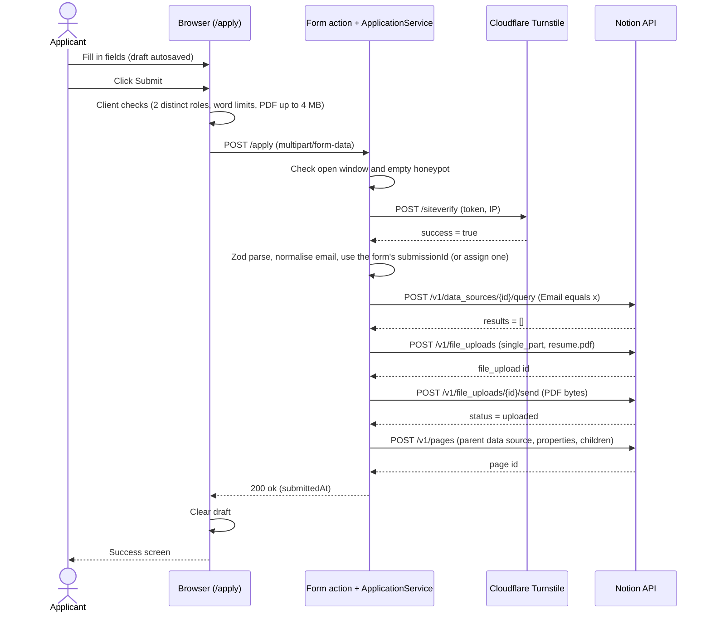

Each submission makes **four Notion requests**, which is well within Notion's average rate limit of 3 requests per second, even near the deadline.

### 6.3 Rejected submissions

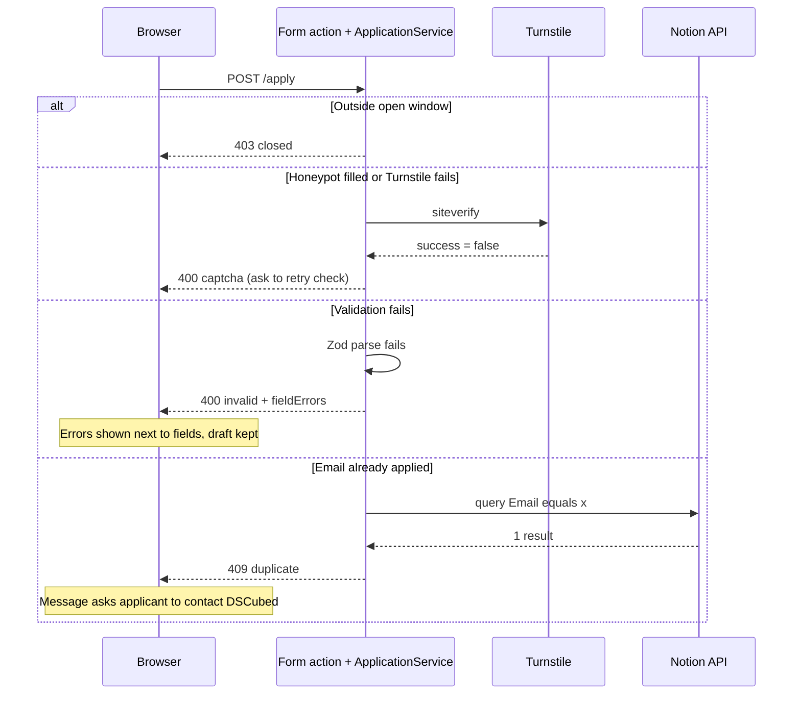

The checks run from cheapest to most expensive. Nothing is written to Notion unless every check has passed.

### 6.4 Notion failure and retry

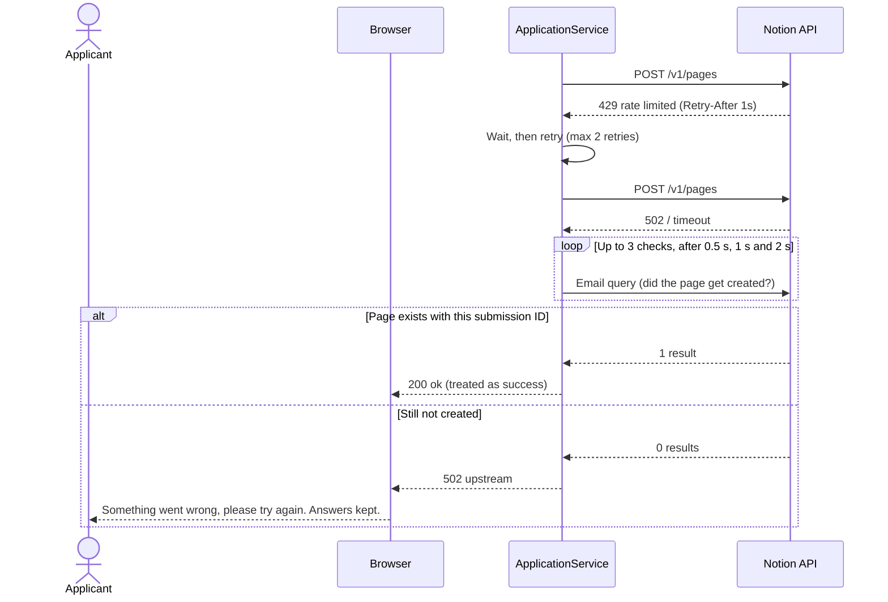

**Retry rules**

- Read requests and file-upload requests are retried up to 2 times after a `429`/`529`, a `5xx`, a timeout or a network error, honouring `Retry-After`.
- Page creation is retried only after a `429` or `529`, because Notion rejected that request without processing it.
- After a timeout or a `5xx` error on page creation, the page may or may not have been created. The repository checks by email up to 3 times (after 0.5 s, 1 s and 2 s) and accepts a page only if its `Submission ID` matches this attempt. This avoids creating duplicate pages.
- The browser posts the same `submissionId` on every attempt of one draft. If the applicant retries after a failure that actually created the page, the service finds that page by email, sees the matching submission ID, and returns success instead of `duplicate`.
- The Notion SDK's own retries are turned off, and each request times out after 10 seconds.
- An unattached file upload left behind by a failed attempt is never used.

### 6.5 AI screening batch job (future)

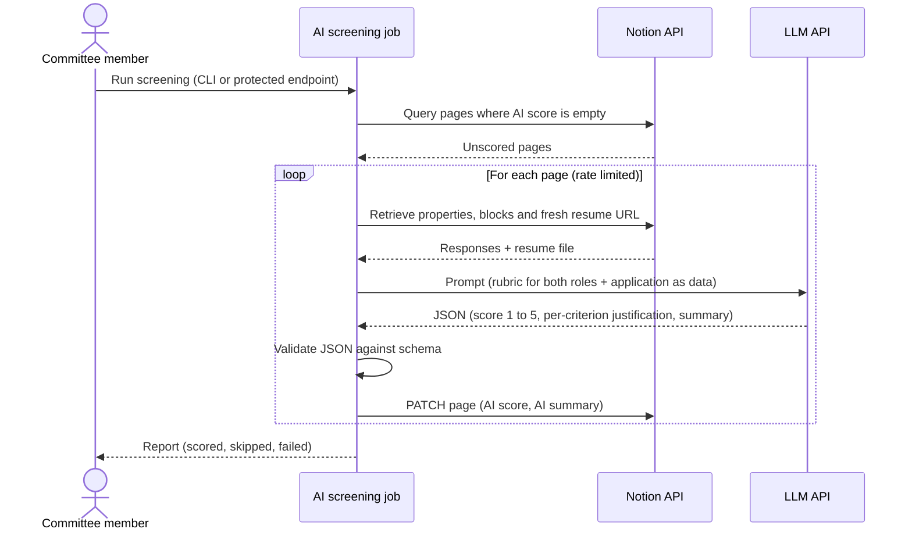

## 7. Data schemas

### 7.1 Notion database: `2027 S1 Applications`

This is created **manually** in the Notion UI, before launch, following the table below. A second copy named `TEST Applications` is used for development.

| Property | Notion type | Filled from | Required | Notes |
|---|---|---|---|---|
| Name | Title | `fullName` | yes | |
| Email | Email | `email` (trimmed, lowercase) | yes | Uniqueness key. Notion does not enforce uniqueness itself; the application does (D5). |
| Degree | Text | `degree` | yes | Free text, because degree names differ between universities. |
| Expected graduation | Select | `graduation` | yes | Options: 2027 Sem 1, 2027 Sem 2, 2028 Sem 1, 2028 Sem 2, 2029 Sem 1, 2029 Sem 2, 2030 Sem 1, 2030 Sem 2 |
| Group interview availability | Multi-select | `availableGroup` | yes | Options: Wed 10 March, Thu 11 March. Must match `interviews.group` in the config exactly. |
| Individual interview availability | Multi-select | `availableIndividual` | yes | Options: Fri 12 March, Sat 13 March. Must match `interviews.individual` in the config exactly. |
| First preference | Select | role name for `firstPreference` | yes | Options are the role names in the config. Create them in advance so their order and colours are controlled. |
| Second preference | Select | role name for `secondPreference` | yes | Same options as First preference |
| Resume | Files & media | uploaded PDF | yes | |
| Submitted at | Date (with time) | server clock | yes | Australia/Melbourne |
| Stage | Status | default value | yes | Applied, Group interview, Individual interview, Offer, Unsuccessful |
| Submission ID | Text | server-generated UUID | yes | Matches a page to the server logs |
| AI score | Number | AI job (future) | no | 1 to 5. Hidden in the default views (anchoring bias). |
| AI summary | Text | AI job (future) | no | Per-criterion justification |

**Recommended Notion views**

- One view per role, showing applicants whose first **or** second preference is that role, grouped by preference.
- A board view grouped by `Stage`.

### 7.2 Logical entity-relationship model

Only `APPLICATION_PAGE` (with its resume and responses) is stored in Notion. `ROLE` and `QUESTION` live in the config file, and the page refers to a role by name.

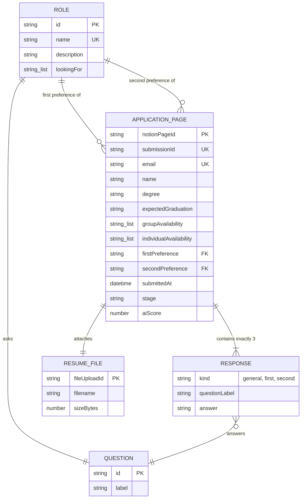

### 7.3 Notion page body layout

The responses are written as page content rather than as properties. This makes them easy to read, and it puts the interview notes directly beneath them.

```text
[heading_2]  Application responses
[heading_3]  General: <general question>
[paragraph]  <answer, max 200 words>
[heading_3]  First preference (Events): <role question>
[paragraph]  <answer>
[heading_3]  Second preference (Media): <role question>
[paragraph]  <answer>
[divider]
[heading_2]  Group interview notes
[paragraph]  (empty)
[heading_2]  Individual interview notes
[paragraph]  (empty)
```

All text is sent as plain `rich_text` with no Markdown interpretation, so applicant input cannot change the page formatting. A 200-word answer is about 1,300 characters. That is under Notion's limit of 2,000 characters per text object, but answers are still split into chunks defensively.

### 7.4 Config schema (TypeScript)

```ts
// src/lib/config/types.ts
export interface Question { id: string; label: string; helpText?: string }

export interface Role {
  id: string;                 // stable slug, e.g. "events"
  name: string;               // must match the Notion select option exactly, e.g. "Events"
  description: string;        // one sentence, shown on the landing page
  lookingFor: {               // shown in a dropdown on the role's card
    intro: string;            // e.g. "We are looking for applicants who:"
    points: string[];
  };
  question: Question;         // exactly one question per role; shown only on the form
  // rubric?: Rubric;         // added in the AI phase
}

export interface RecruitmentConfig {
  cycle: "2027-S1";
  opensAt: string;            // ISO 8601 with +11:00 offset
  closesAt: string;
  wordLimit: 200;
  maxResumeBytes: number;     // 4 * 1024 * 1024
  interviews: {
    group: readonly [string, ...string[]];      // sessions, e.g. "Wed 10 March"
    individual: readonly [string, ...string[]]; // days; both must match the Notion options
  };
  outcomesDate: string;       // display only, e.g. "Sun 14 March"
  graduationOptions: readonly string[];
  generalQuestion: Question;
  roles: readonly Role[];
}
```

```ts
// src/lib/config/recruitment.ts (2027 S1 content, abridged)
export const recruitment = {
  cycle: "2027-S1",
  opensAt: "2027-02-22T09:00:00+11:00",
  closesAt: "2027-03-07T23:59:59+11:00",
  wordLimit: 200,
  maxResumeBytes: 4 * 1024 * 1024,
  interviews: {
    group: ["Wed 10 March", "Thu 11 March"],
    individual: ["Fri 12 March", "Sat 13 March"],
  },
  outcomesDate: "Sun 14 March",
  graduationOptions: ["2027 Sem 1", "2027 Sem 2", "2028 Sem 1", "2028 Sem 2",
                      "2029 Sem 1", "2029 Sem 2", "2030 Sem 1", "2030 Sem 2"],
  generalQuestion: {
    id: "why_join",
    label: "Why do you want to join the DSCubed committee, and what would you bring to the team?",
  },
  roles: [
    role("events", "Events", "<one-sentence description>",
         { intro: "We are looking for applicants who:", points: ["..."] },
         "<the Events question>"),
    // ...seven roles: events, graphics, media, hr, industry, education, products
  ],
} satisfies RecruitmentConfig;
```

### 7.5 Submission payload (`multipart/form-data`)

| Field | Type | Validation (client and server) |
|---|---|---|
| `fullName` | text | Trimmed, 1 to 100 characters |
| `email` | email | Valid format, at most 254 characters, then trimmed and lowercased |
| `degree` | text | Trimmed, 1 to 150 characters |
| `graduation` | select | One of `graduationOptions` |
| `availableGroup` | checkboxes (repeated field) | At least one of `interviews.group` |
| `availableIndividual` | checkboxes (repeated field) | At least one of `interviews.individual` |
| `firstPreference` | select | A role `id` from the config |
| `secondPreference` | select | A role `id`, different from `firstPreference` |
| `answerGeneral` | textarea | 1 to 200 words, at most 2,000 characters |
| `answerFirst` | textarea | Same as above |
| `answerSecond` | textarea | Same as above |
| `resume` | file | Required, `.pdf`, at most 4 MB, first bytes are `%PDF-` |
| `cf-turnstile-response` | hidden | Verified on the server with Cloudflare |
| `website` | hidden honeypot | Must be empty |
| `submissionId` | hidden | A UUID kept with the browser's draft and reused on every attempt. Optional; the server assigns one if it is missing or invalid. |

Words are counted with `text.trim().split(/\s+/).filter(Boolean).length`. The browser and the server use this same function, which is shared through `src/lib/domain/words.ts`.

### 7.6 Validation schema (Zod sketch)

```ts
const roleIds = recruitment.roles.map(r => r.id) as [string, ...string[]];
const answer = z.string().trim().max(2000)
  .refine(t => countWords(t) >= 1, "Required")
  .refine(t => countWords(t) <= recruitment.wordLimit, `Max ${recruitment.wordLimit} words`);

export const applicationSchema = z.object({
  fullName: z.string().trim().min(1).max(100),
  email: z.string().trim().toLowerCase().email().max(254),
  degree: z.string().trim().min(1).max(150),
  graduation: z.enum(recruitment.graduationOptions as [string, ...string[]]),
  // One or more options, read with formData.getAll(); deduplicated and put in config order.
  availableGroup: z.array(z.enum(recruitment.interviews.group)).min(1, "Select at least one session"),
  availableIndividual: z.array(z.enum(recruitment.interviews.individual)).min(1, "Select at least one day"),
  firstPreference: z.enum(roleIds),
  secondPreference: z.enum(roleIds),
  answerGeneral: answer, answerFirst: answer, answerSecond: answer,
  resume: z.instanceof(File)
    .refine(f => f.size > 0 && f.size <= recruitment.maxResumeBytes, "PDF up to 4 MB")
    .refine(f => f.type === "application/pdf", "Must be a PDF"),
}).refine(d => d.firstPreference !== d.secondPreference, {
  path: ["secondPreference"], message: "Choose two different roles",
});
// The %PDF- signature check runs on the server after parsing.
```

## 8. Interface contract: `POST /apply`

This is a SvelteKit default form action, progressively enhanced with `use:enhance`. The page still works without JavaScript, although the dynamic questions and the word counters then don't appear.

| Outcome | HTTP status | Action data | UI behaviour |
|---|---|---|---|
| Success | 200 | `{ ok: true, submittedAt }` | "Thanks for applying" screen; draft cleared |
| Closed | 403 | `{ reason: "closed" }` | "Applications closed" |
| CAPTCHA failed | 400 | `{ reason: "captcha" }` | Ask the applicant to retry the check; draft kept |
| Invalid | 400 | `{ reason: "invalid", fieldErrors }` | Errors shown beside the fields; draft kept |
| Duplicate | 409 | `{ reason: "duplicate" }` | "An application with this email already exists. Contact DSCubed if you need to change it." |
| Notion error | 502 | `{ reason: "upstream" }` | "Something went wrong, please try again." Draft kept |

The action never sends the uploaded file back to the browser. After a failed submission the chosen file stays attached, because the page is not reloaded; after a reload the applicant has to attach it again.

Outside the application window, `/apply` shows "Applications closed" instead of the form, and the buttons on the landing page and in the nav become a greyed-out "Applications closed" label. The landing page is prerendered, so it works out the window from the browser's clock.

## 9. Reliability, logging and limits

- **Logging:** each request logs one JSON line to the Vercel function logs: `{ submissionId, outcome, durationMs }`, plus `step` (which Notion call failed) for `upstream`, and `alreadyCreated` when a retry found its own page. Names, emails, answers and resume contents are **never** logged.
- **Notion rate limit:** 4 requests per submission. Retries follow `Retry-After` (Section 6.4).
- **Payload limit:** Vercel's request body limit (about 4.5 MB) sets the 4 MB resume cap. The browser checks the size before uploading.
- **Draft safety:** every answer, including the interview checkboxes, is saved to `localStorage` while the applicant types (debounced to 500 ms), with the draft's `submissionId`. The resume file is not saved, since browsers cannot persist file inputs, so after a reload the applicant has to attach it again.

## 10. Security and privacy

- **Secrets:** `NOTION_TOKEN`, `NOTION_DATA_SOURCE_ID`, `NOTION_TEST_DATA_SOURCE_ID` and `TURNSTILE_SECRET_KEY` are server-only environment variables. Only `PUBLIC_TURNSTILE_SITE_KEY` is sent to the browser.
- **Least privilege:** the Notion integration is an *internal integration* connected to the 2027 S1 database **only**. Its capabilities are read, insert and update content. Update is needed only by the future AI job.
- **Access:** the database is shared only with committee members who are involved in recruitment.
- **Collection notice:** shown on the form. It states what is collected and why, who can see it, how long it is kept and how to request deletion. If AI screening is introduced, the notice also states that AI is used to assist screening and that people make every decision. Check university and student union requirements for clubs that handle personal information.
- **Retention:** the committee decides when unsuccessful applications are deleted after the cycle, for example at the end of 2027 S1.
- **Input handling:** all text is sent to Notion as plain text. The resume type is checked by its file signature, not only by its extension.

## 11. AI screening extension (future)

The core design already supports AI screening:

1. **Data:** the `AI score` and `AI summary` properties already exist, hidden in the default views.
2. **Config:** add an optional `rubric` to each `Role`, consisting of criteria with a descriptor for each score from 1 to 5. Add one shared rubric for the general question.
3. **Repository:** add `listUnscored()` and `writeAiResult()` to `NotionApplicantRepository`.
4. **Job:** a CLI script, or a protected endpoint, that follows Section 6.5.

Safeguards:

- Applicant text and resume content are passed to the model as **data**, kept clearly separate from the instructions. This defends against prompt injection, such as hidden text in a resume telling the model to "score 5".
- The output must match a JSON schema. Any output that doesn't is rejected and reported.
- Each score comes with a justification for each criterion, so directors can check it rather than trust it blindly.
- The AI never changes `Stage`. People make every decision.

## 12. Project structure

```text
src/
  lib/
    config/
      types.ts                 RecruitmentConfig, Role, Question
      recruitment.ts           2027 S1 content (the file edited for each cycle)
      landing.ts               landing page copy
      notice.ts                collection notice
    domain/
      schema.ts                Zod schema built from config
      words.ts                 countWords (shared by client and server)
      window.ts                application window state and date formatting
      application.ts           Application type, SubmitResult union
    apply/                     form state, validation, progress and draft autosave (browser)
    server/
      applicationService.ts    orchestrates submit()
      container.ts             builds the service from environment variables
      ports.ts                 ApplicantRepository, CaptchaVerifier, Clock
      fakeRepository.ts        in-memory repository for development and tests
      notion/
        repository.ts          NotionApplicantRepository
        pageBuilder.ts         properties + body blocks
        retry.ts               retry policy
      turnstile.ts             TurnstileVerifier and honeypot check
    components/
      landing/                 hero, about, process, FAQ, closing call to action
      apply/                   form sections, success and closed screens
      form/                    text, select, radio and checkbox fields
      layout/                  header and footer
  routes/
    +page.svelte               landing page (prerender = true)
    apply/
      +page.svelte             form
      +page.server.ts          load (open window) + default action
tests/
  unit/                        schema, words, pageBuilder, service with fakes
  integration/                 repository against TEST Applications database
  e2e/                         Playwright: form and landing page against a production build
```

## 13. Setup checklist

1. In Notion, create the `2027 S1 Applications` database and a `TEST Applications` database, following Section 7.1.
2. Create an internal Notion integration. Connect it to both databases (open the database menu, then **Connections**).
3. Record each database's **data source ID** for the environment variables.
4. Create a Cloudflare Turnstile widget for the production domain and for `localhost`.
5. Create the Vercel project from the GitHub repository. In production, set `NOTION_DATA_SOURCE_ID` to the real database. In preview, set `NOTION_TEST_DATA_SOURCE_ID` to the test database and `APPLICANT_REPO=notion`.
6. Fill in `recruitment.ts`: roles, descriptions, questions, open and close times, interview dates.
7. Run a full end-to-end test with committee members on a preview deployment.

## 14. Implementation plan

| Phase | Deliverable | Done when |
|---|---|---|
| 1. Foundations | SvelteKit scaffold, config types, draft 2027 S1 config, Zod schema, `countWords` | Unit tests pass for every validation rule |
| 2. Notion integration | Both databases created; repository and page builder | An integration test creates a correct page, with its resume, in `TEST Applications` |
| 3. Application form | `/apply` with dynamic questions, word counters, draft autosave, error display | Every outcome in Section 8 renders correctly |
| 4. Landing page | `/` with about, role cards, timeline, Apply now | Role cards come from the config |
| 5. Hardening and launch | Turnstile, honeypot, open window, logging, retry policy, collection notice | Committee end-to-end test passes; production deployed |
| 6. AI screening (later) | Rubrics, job, write-back | Scores checked against human scores on a sample |

## 15. Open items

- [ ] Directors to confirm the role descriptions, "looking for" points and one question per role (drafted in the config)
- [ ] Wording of the general question (drafted in the config)
- [x] Application open and close times (22 Feb 9:00 am to 7 Mar 11:59 pm, 2027)
- [x] Group and individual interview dates (10 to 11 March and 12 to 13 March; outcomes 14 March)
- [ ] Wording of the collection notice, and the retention period
- [ ] Domain: a `*.vercel.app` subdomain or a custom domain
- [ ] Which committee members get access to the Notion database
